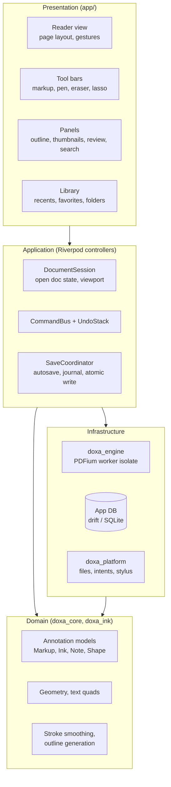
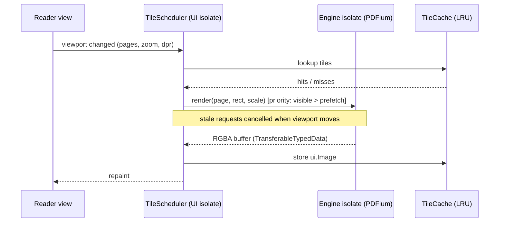
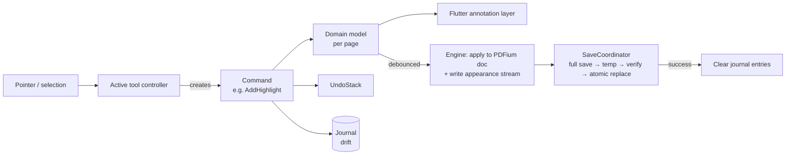

# 03 — Architecture

## 1. Principles

1. **The study loop is the hot path.** Reading, markup and ink get dedicated rendering paths. Nothing else may add latency to them.
2. **PDF is the source of truth for annotations.** No proprietary sidecar format. App-only data (recents, progress, presets) lives in a local database.
3. **The engine sits behind an interface.** The UI never calls PDFium directly ([NFR-MAINT-004](02-requirements.md#26-maintainability-maint)).
4. **PDFium is single-threaded.** All native calls go through one engine worker with a priority queue.
5. **Pure Dart where possible.** Native code only for PDFium and platform features Flutter lacks (low-latency ink, SAF).

## 2. Repository layout

A monorepo using Dart pub workspaces ([ADR-0004](../adr/0004-monorepo-with-pub-workspaces.md)):

```
doxa-pdf/
├── app/                       # Flutter application (android/, linux/, windows/, lib/)
│   └── lib/
│       ├── features/          # reader/, markup/, ink/, review/, library/, settings/
│       ├── shared/            # widgets, theming, l10n
│       └── main.dart
├── packages/
│   ├── doxa_core/             # Pure Dart domain: models, geometry, commands, undo/redo, annotation serialization
│   ├── doxa_engine/           # Engine interface + PDFium implementation (FFI, worker isolate, appearance-stream writer)
│   ├── pdfium_ffi/            # ffigen-generated bindings + native library loading/bundling
│   ├── doxa_ink/              # Stroke model, smoothing, pressure → outline geometry, hit testing, erasing
│   ├── doxa_dict/             # Pure Dart offline dictionaries: StarDict parsing, index, lookup (proposed, ADR-0009)
│   └── doxa_platform/         # Plugin: SAF/file access, intents, file associations, low-latency ink surface (Android)
├── tools/                     # Scripts: fetch/verify PDFium, test corpus, release helpers
├── test_corpus/               # Small, license-cleared PDFs used in tests (large corpus fetched on demand)
└── docs/
```

Dependency rule: `app → doxa_engine, doxa_ink, doxa_platform → doxa_core`; `app → doxa_dict` (pure Dart, depends on nothing in the workspace). `doxa_core` depends on nothing Flutter-specific,
so it stays testable with plain `dart test`.

## 3. Layered view



### Technology choices

| Concern | Choice | Notes |
|---|---|---|
| UI | Flutter (stable channel, pinned with FVM) | [ADR-0001](../adr/0001-flutter-as-ui-framework.md) |
| PDF engine | PDFium through Dart FFI | [ADR-0002](../adr/0002-pdfium-as-pdf-engine.md), details in [04](04-pdf-engine.md) |
| State management | Riverpod (with code generation) | Testable, no BuildContext coupling |
| Navigation | go_router | Deep links for "open file" intents |
| Local DB | drift (SQLite) | Library, progress, bookmarks, presets, journal |
| Settings | drift table (typed), not shared_preferences | One storage backend, migrations |
| i18n | `flutter_localizations` + ARB + `intl` | en, pt-BR at v1.0 |
| Logging | `package:logging` → rotating local file | Attached to bug reports by the user |

## 4. Engine worker and rendering pipeline

PDFium has global state and is not thread-safe. One **engine isolate** owns every PDFium handle.
The UI talks to it through a typed request/response protocol with priorities and cancellation.



- **Two levels of detail**: a low-resolution full-page image (fast first paint, used while zooming) plus 256–512 px **tiles** at the current zoom.
- **Annotations are not baked into tiles.** Page content is rendered with PDFium *without* the annotation flag. Annotations of types Doxa owns
  (markup, ink, notes, shapes) are drawn by Flutter as vectors from the domain model. Edits then show up instantly, with no tile re-render
  (NFR-PERF-005). Foreign annotations are baked into the tiles by a separate **read-only render instance** of the document, in which Doxa's own
  annotations are hidden in memory ([ADR-0005](../adr/0005-rendering-pipeline-and-foreign-annotations.md), [Spike A](../spikes/A-rendering.md)).
- **Night/sepia** modes are applied as color filters on page tiles only. Annotation colors are kept, with an optional "adapt annotation colors" setting.
- Long operations (search, text extraction, export) are chunked per page and yield, so render requests can interleave.

## 5. Annotation data flow



- **Commands** are small, serializable and invertible (`AddAnnotation`, `UpdateAnnotation`, `DeleteAnnotations`, `MoveAnnotations`, `EraseStrokeSegments`).
  The undo stack, the crash journal and the engine sync all consume the same command objects.
- **Identity**: every annotation gets a stable `/NM` (UUID) so commands target it across reloads. Missing `/NM` values on foreign annotations are assigned in memory and only written when that annotation is edited.
- **Unknown keys are preserved.** Edits patch specific keys and never rebuild foreign annotations from scratch (FR-ANNO-002).
- **Appearance streams** ([ADR-0008](../adr/0008-annotation-save-strategy.md)): ink gets an AP built from page objects. Text markup is written without AP in the MVP, and every tested reader generates it. The editing document is never rendered with `FPDF_ANNOT`, because that makes PDFium rewrite foreign annotations. See [04 §4](04-pdf-engine.md#4-writing-annotations).

## 6. Ink architecture

Ink is the hardest real-time path, so it has its own pipeline in `doxa_ink`:

1. **Input**: a raw `Listener` (not gesture arenas) receives pointer events with `kind`, `pressure`, `tilt` and `buttons`. Coalesced and predicted samples come in where the platform provides them.
2. **Palm rejection**: in stylus-only mode, touch pointers go to scroll/zoom and stylus pointers go to the active tool. When a stylus is detected, the mode turns on automatically (FR-INK-006).
3. **Live layer**: the in-progress stroke is drawn incrementally on a dedicated `RepaintBoundary` above the page, so only the new segment is drawn each frame.
4. **Smoothing**: none by default. The S Pen's raw input is clean ([Spike B](../spikes/B-ink.md)). Optional light arc-length smoothing (2–4 px) is available, but not a One-Euro filter. Then pressure-to-width mapping through the user's curve, then a variable-width outline polygon (perfect-freehand style).
5. **Commit**: on pointer up, the stroke becomes a command. Strokes drawn within a short window on the same page are grouped into one Ink annotation (FR-INK-011).
6. **No native fast path**: Spike B measured 5–7 ms event → raster (≈ 15–20 ms end-to-end) in pure Flutter, so the planned Android
   front-buffer overlay is not built ([ADR-0006](../adr/0006-ink-rendering-in-flutter.md)). Committed ink must live in the **tile cache**.
   Replaying it as vectors every frame does not scale, and erasing and editing invalidate only the affected tiles.

Storage: `/InkList` keeps the smoothed centerline points (for compatibility and editing), `/BS /W` keeps the base width, and the
**appearance stream** draws the true variable-width filled outline. Raw pressure samples go in a private key (`/DoxaPressure`),
so Doxa can re-edit strokes losslessly while other readers still display the appearance.

## 7. Persistence

| Data | Where | Notes |
|---|---|---|
| Annotations | Inside the PDF | Source of truth |
| Unsaved operations | `journal` table | Replayed on crash recovery, cleared after a successful save |
| Library: recents, favorites, progress, last view state | `documents` table | Keyed by **document identity** (below) |
| Bookmarks | `bookmarks` table | Optionally mirrored into the outline on export |
| Settings, pen presets, palettes | `settings`, `presets` tables | Exportable as JSON |

**Document identity**: a hash of (size + first 64 KB + last 64 KB) plus the PDF `/ID` when present. This survives renames and moves, and
the app uses it to re-associate progress. Locations are stored separately: a path on desktop, a persisted SAF URI permission on Android.

## 8. Platform integration (`doxa_platform`)

| Capability | Android | Windows | Linux |
|---|---|---|---|
| Open/save | SAF `ACTION_OPEN_DOCUMENT` + persistable permissions, write via `ContentResolver` | Native file dialogs, direct paths | XDG portals (works in Flatpak) |
| "Open with" | `VIEW` intent filter for `application/pdf` | File association via installer + single-instance IPC | `.desktop` `MimeType=application/pdf` + D-Bus single instance |
| Stylus | MotionEvent pressure/tilt/buttons; low-latency overlay | Pointer events with pen pressure (validate in M0) | GTK tablet events (validate in M0) |
| Atomic save | Write temp in cache → copy into URI with truncation (fallback, see risks) | `ReplaceFileW` | `rename(2)` in the same directory |

## 9. Error handling & observability

- Engine errors map to typed failures (`PasswordRequired`, `CorruptFile`, `UnsupportedFeature`, `IoFailure`) that the UI turns into friendly messages.
- Logs go to a local rotating file. **Nothing is sent automatically.** "Report a problem" builds a bug report the user can review and attach (NFR-SEC-005).
