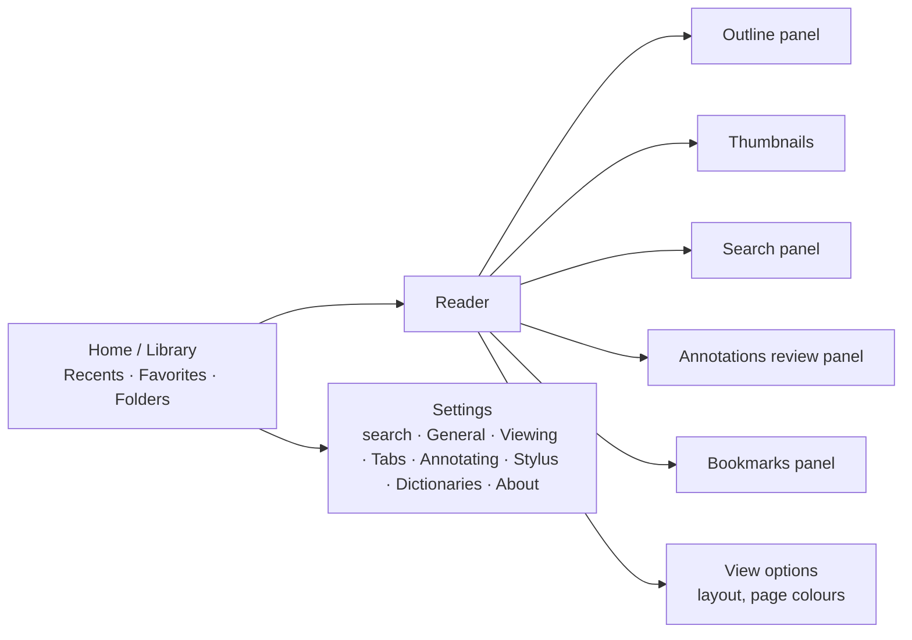

# 05 — UX Design

## 1. Design principles

1. **The page is the interface.** Chrome is minimal while reading and toolbars auto-hide. Tools appear where the hand already is.
2. **One gesture to mark up.** The highlighter, pen and eraser are always one tap away when a document is open.
3. **Predictable input.** The stylus always writes with the current pen. Fingers read (scroll, zoom, tap), and finger tools are picked from the toolbar. Mouse/keyboard follow desktop conventions.
4. **Familiar, not copied.** Reading and annotating should feel very close to the most popular commercial mobile PDF readers, so people switching to Doxa feel at home ([§8](#8-familiar-layout-and-workflows)). The visual identity stays Doxa's own: Material 3, own logo, icons and colours ([Vision §3](01-vision-and-scope.md#3-product-inspiration-and-originality)).

## 2. Screen map

View options saves layout, cover page, tap zones, keep zoom and page colours as global defaults. Right-to-left page order is per document.

**Library file actions** (FR-FILE-011, maintainer decision 2026-11-26): each document in Recents, Favorites and a library folder has a
⋮ menu with **Rename**, **Move** and **Delete**. Long-press selects several documents and shows a selection bar with the same actions
for the whole selection (except Rename), plus **Select all**; while selecting, a tap selects, and Back or a tab change ends selection. Rename keeps the `.pdf` extension and the reading state. Delete always asks first.
Move opens Doxa's own folder picker: the library folders on the same storage, then their subfolders level by level, and
**Move here**. It is offered only for documents inside a library folder, because the system can move only between folders the app has access to.

## 3. Reader layout by size class

| Size class | Layout |
|---|---|
| **Compact** (phones) | Top app bar, a bottom action bar in portrait, and the annotation tools as a **second row at the top** (§7, "Phones"). Panels open as full-screen pages. |
| **Medium** (small tablets, split screen) | Tabs row + annotation toolbar **fixed at the top**. The side panel docks on the left when it fits, otherwise it opens as a modal sheet. |
| **Expanded** (large tablets, desktop) | Tabs row, annotation toolbar **fixed at the top**, a **side panel docked on the left** (bookmarks, contents, annotations) and a full-screen thumbnail grid (§7). |

### Annotation toolbar (all sizes)
`[Highlighter ▾] [Underline/Strike ▾] [Pen 1] [Pen 2] [Highlighter pen] [Eraser ▾] [Lasso] [Note] [Shapes ▾] | [Undo] [Redo] | [Stylus-only ✎]`

- Long-press or a second tap on a tool opens its options (color palette, width, opacity, pressure).
- Tool state is **sticky** until the user switches tools or presses Esc or the back gesture.
- The current color appears as the tool's tint, so the state is visible at a glance.

## 4. Key interactions

| Scenario | Touch | Stylus | Mouse/keyboard |
|---|---|---|---|
| Scroll/zoom | Drag / pinch | Drag (if stylus-only off) | Wheel / Ctrl+wheel |
| Select text | Long-press, then handles | Long-press or side button | Click-drag |
| Look up a word | Select it → **Dictionary** (popup; bottom sheet on phones) | Same | Select → Dictionary (context menu) |
| Highlight (tool active) | Drag over text | Drag over text | Drag |
| Write | Pen tool | Always writes in stylus-only mode | Pen tool + drag |
| Erase | Eraser tool | Eraser tip / side button | Eraser tool, or `E` |
| Undo | Two-finger tap (optional), toolbar | — | Ctrl+Z / Ctrl+Shift+Z |
| Edit annotation | Tap → context bar | Tap | Click, Delete key |

Default desktop shortcuts: `H` highlight, `U` underline, `P` pen, `E` eraser, `L` lasso, `N` note, `Esc` back to view,
`Ctrl+F` search, `Ctrl+O` open, `Ctrl+W` close tab, `Ctrl+Tab` next tab, `F11` fullscreen, `Ctrl+0/1/2` zoom presets.

## 5. Visual design

- Material 3 with a **Doxa purple seed color** (`#7048E8`) and dynamic color on Android 12+.
- Default palette for study markup, chosen for legibility under multiply blend and tuned for color-vision deficiencies: yellow, green, blue, pink, orange, purple. Users can relabel colors (for example "Definition", "Exam", "Doubt"), and the labels drive review-panel filtering.
- App icon and brand assets are original. The icon is the italic lowercase delta (δ, for δόξα) of EB Garamond (weight 600),
  in four colours, magenta → green → purple → orange, with hard cuts (#78). Sources are in [`assets/brand/`](../../assets/brand/)
  (dark, light, transparent, Android adaptive foreground, single-colour), rebuilt by `tools/generate_brand_glyph.py`.

### The Doxa look (maintainer decision 2026-11-26, #80)

Chosen from five directions: the **Dashboard** home and the **Night** reader. The mockups are on a private design canvas that the
maintainer keeps; this section is what the app follows.

- **One font family:** Manrope (SIL OFL 1.1, bundled; source in `app/assets/fonts/README.md`) for the whole interface. Headings are
  heavy (800) and slightly tight. PDF pages keep their own fonts.
- **Colours:** neutral surfaces, the same with dynamic colour on or off; only the accent follows the seed or the wallpaper.

  | Role | Light | Dark |
  |---|---|---|
  | Background | `#F5F6FA` | `#161A23` |
  | Cards, list rows | `#FFFFFF` | `#1E2330` |
  | Raised controls | `#E8EAF0` | `#262C3A` |
  | Behind the PDF page | `#E8EAF0` | `#10131A` |
  | Text / secondary text | `#161A23` / `#5A6070` | `#E6E8EF` / `#9AA3B5` |
  | Lines | `#DDE0E8` | `#262C3A` |

  The four brand colours (magenta `#D6336C`, green `#2BAE66`, purple `#7048E8`, orange `#F08C00`) mark folders and tabs, never
  text on their own. Text keeps a 4.5:1 contrast.
- **Shapes:** cards 18–24 px corners, buttons and fields 14 px, dialogs 24 px; no elevation shadows on cards.
- **Home (Dashboard):** no tabs. One screen holds a large **Continue reading** card (cover, title, page, a progress ring and
  "Continue on p. N"), **Favorites** as a shelf of covers, **Folders** as tiles (with Add folder), and **Recents** as rows. Each
  section has "See all", which opens its full list (the current lists, with search, sort and multi-selection).
- **Reader (Night):** a compact app bar (back, side-panel button, title, page number in tabular figures, tools). Under it, the tab
  row has browser-like tabs with a top stripe in the document's colour. Both hide together in full screen.
  - The **side panel** and the **thumbnail grid** follow "Reader navigation and chrome" in §7.
- **App theme and page colour are separate:** light and dark change the bars, tabs and panels. The page follows its own colour
  option in View options (normal, night, sepia, custom).

## 6. Accessibility

- Semantic labels on every control, with tooltips on desktop.
- Full keyboard navigation and a visible focus indicator.
- Respects OS text scaling and reduced motion. High-contrast theme.
- Annotation colors are never the only signal: the review panel also shows type icons and color labels.

## 7. Decisions from the MVP session (2026-11-24)
- **No explicit annotate mode for the stylus**: the S Pen always writes. Finger tools (markup, notes, shapes) are chosen in the toolbar, and otherwise the finger only reads.
- **Toolbar fixed at the top** on tablets. Phones also put the tools in a row at the top (changed 2026-11-26, §7 "Phones"); the bottom holds the tool's presets.
- **Tabs on tablets** as well as desktop.
- **Tabs (FR-FILE-007), maintainer decisions 2026-11-26:**
  - On medium and expanded widths the tab row sits **under the reader's app bar** and hides with it. Each tab has its own close button,
    and a long press drags a tab to another place.
  - On phones a button in the reader's app bar shows how many tabs are open. It opens a **grid of the tabs' first pages**; a tap shows
    a tab, and ✕ closes it.
  - The open tabs come back after a restart. Each document reopens when its tab is first shown, and a file that is gone closes its tab with a message.
  - Opening a document from home **adds a tab**. A document that is already open shows its tab instead.
  - Back returns home and keeps the tabs.
  - There is **no fixed tab limit**. Only the active tab keeps its document open in the engine; the others keep their place and reopen
    there when shown. One large scanned book alone comes close to the NFR-PERF-006 budget, so several open documents would not fit.

### Reader navigation and chrome (maintainer decisions 2026-11-26)
Generic requirements for the reader, written from observations of the reference layout (§8) and the maintainer's choices.
Each point below is the target for alpha 1 unless it names a feature that is not built yet; a feature that is not built is never shown.

**Bars and taps**
- A **single tap in the middle** of the page hides the app bar, the tab row, the page indicator, the scrubber, the history control and the
  system bars together; the next tap shows them again. This works in every mode, not only in full screen (#95). At fit zoom the page re-fits to the taller area.
- Bars **never hide on scroll**.
- With the edge-tap option on, a tap within about the outer **10–15% of the screen width** turns to the previous or next page (or spread)
  and does not toggle the bars.

**Page indicator, scrubber and history**
- The **page indicator** sits at the top left of the page area, under the tab row: the page label, then the position and total, for
  example "iv (6 / 120)". In a spread it names the last visible page. At fit zoom in paged layouts it is a plain strip; when zoomed in or
  scrolling continuously it becomes a small floating pill over the page. The page number leaves the app bar.
- A **scrubber grip** sits on the bottom edge of the page area. Its position across the width maps to the page. Dragging it turns pages live
  and updates the indicator, with a thin track shown only while dragging and no preview bubble. In vertical scrolling it moves to the right
  edge and works as a fast-scroll handle. Its range follows the page area, so it shrinks when the side panel is open.
- After a jump (contents entry, thumbnail, link, search result) a small **back/forward control** appears at the bottom left. It walks the
  jump history like a browser and fades to a faint state when idle.

**Zoom**
- No zoom buttons, percentage or slider in the bars. **Pinch** zooms freely.
- **Double tap** toggles between fit and about 2.5× around the tapped point.
- **Fit page** or **fit width** is a setting (Settings → Viewing), default fit page. **Keep zoom when turning pages** is a setting, on by default.
- Desktop keeps its keyboard zoom shortcuts (§4).

**Side panel** (bookmarks, contents, annotations)
- Opens and closes with its app-bar button. It docks **on the left** (maintainer choice), below the tab row, so the app bar and tabs stay
  full width above it. It takes about a quarter of the width in landscape and about two fifths in portrait on tablets; on phones it is a full-screen sheet.
- It **docks, never overlays**: no scrim, and the page area narrows. At fit zoom the page re-fits to the narrower area. When zoomed in, the
  zoom and position are kept and the page is clipped at the panel. Closing it gives the width back with the same zoom and position.
- Three icon tabs switch its content, in this order: **Bookmarks**, **Contents**, **Annotations**. The header shows the section name and a close
  button, plus the section's own tools (search, and expand/collapse all for contents; sort and filter for annotations).
- Contents rows show the title on the left and the **page label** on the right; nested entries are indented under a chevron that expands them.
- Tapping an entry jumps there and **keeps the panel open** on tablets (it closes on phones). A tap on the page toggles the bars and leaves
  the panel open; when the bars hide, the panel takes the full height.

**Thumbnails**
- A separate app-bar button opens a **full-screen thumbnail grid** that replaces the reader, with its own bar and back arrow (the tab row is hidden).
- The grid adapts to the width: about 4 columns in portrait and 6 in landscape on the reference tablet. Each thumbnail has its page label
  centred at the bottom edge, and the current page's label uses the accent colour.
- Tapping a thumbnail opens that page and closes the grid, keeping the zoom. The back arrow and system Back close the grid and stay in the document.
- Page editing from the grid (reorder, insert, delete) comes with the page features of a later alpha.

**View options**
- A **centred dialog** over a dimmed reader (about half the width in landscape, three quarters in portrait). Changes apply live behind it, and
  it stays open until **OK**.
- In order: **Layout** as a 2×2 choice grid (single page, two pages, cover + two pages, and reflow when it exists); **Vertical scrolling**
  as a switch (off = horizontal paging); **Page colour** as three presets (normal, night, sepia) and a "more" button that opens a grid of
  paper/text combinations with custom colours; **Actions** (rotate, crop) when they are built.
- Two pages pair from the first page: (1, 2), (3, 4). Cover + two pages shows page 1 alone on the right half, then (2, 3), (4, 5), and a lone last
  page on the left half. Turning moves by spread.

**Settings**
- A **search field** at the top that filters settings as the user types.
- Categories in order: **General, Viewing, Tabs, Annotating, Stylus** (plus Dictionaries and About, which Doxa has). Each category is one
  scrolling page with section headers; there are no deeper sub-pages.
- Each row has a title, a one-line description and a trailing switch; a choice opens a small dialog with radio options.
- Doxa's own settings content stays ours: categories and controls follow this structure, and the texts are written by us.

**Phones** (compact width; observed in portrait at about 360 × 800 dp and in landscape at about 800 × 360 dp)
- Same as above: the middle tap that hides everything, the page indicator pill, the back/forward control, double tap, no zoom buttons, and the
  centred view-options dialog. In landscape the dialog scrolls, and its OK button stays pinned at the bottom.
- **Default layout:** continuous vertical scrolling, with the scrubber grip on the right edge. Portrait fits the width, and landscape fits the
  page height. When the bars hide in landscape, the page re-fits to the full height.
- **Portrait bars:** the top bar holds back, the tool-set selector, undo, the tab counter and the overflow menu. A **bottom bar** holds four
  actions: thumbnails, search, reading mode and the navigation list. Both hide with the middle tap.
- **Landscape bars:** there is no bottom bar. Its actions join the top bar, and the top bar draws over the page.
- **Tabs:** there is no tab row. A counter opens the tab grid of §7 "Tabs": two columns of cards, each with the name, a close button and the
  current page, with long-press drag to reorder.
- **Navigation list and thumbnails** are **full-screen pages** in both orientations, with a back arrow, the same section tabs (contents
  first) and the same rows. Tapping an entry or a thumbnail **closes the page** and jumps. Thumbnails use 3 columns in portrait and 6 in landscape.
- **Annotation tools:** choosing a tool set adds a **second row under the top bar**, never at the bottom. Undo moves into that row.
  - **Portrait:** the row scrolls sideways. A selected tool replaces the bottom bar with a **preset bar**: four presets of that tool and a close button.
  - **Landscape:** all tools fit in the row. The presets open inline in the row, next to the selected tool, and tapping the selected tool again deselects it.
  - The chevron on the active preset opens a **style sheet**: a live preview, then colour, thickness and opacity. A bottom sheet in portrait, a
    centred panel about half the width in landscape. The colour row opens a palette page inside the same sheet.
  - The page indicator and the back/forward control hide while a tool is active.
- **Text selection:** two handles and a floating menu under the selection, with copy, translate, dictionary and more, and the markup actions
  (highlight, underline, squiggly, strikeout). The menu uses two rows in portrait and one row in landscape. A tap elsewhere clears it.
- **Search:** the top bar becomes the search field. Previous and next sit in a pill at the bottom right (where the back/forward control is,
  at the bottom left). A results list opens as a full-width page under the field, with section, snippet and page.
- **Settings:** the categories are a list, and each one opens its own page.
- **Back:** unlike the reference, system Back first clears a text selection, then leaves the active tool, and only then leaves the document.
  The reference closes the document straight away in those states, which loses context.

### Still open
- (none for the reader layout)

## 8. Familiar layout and workflows

Maintainer decision (2026-11-24): the viewer should **strongly resemble the layout and workflows of the leading commercial mobile PDF readers** without being an exact copy.

| Resemble (layout, flows, conventions) | Keep original (identity) |
|---|---|
| Screen structure: top app bar, document tabs, annotation toolbar at the top, side/bottom panels | Name, logo, app icon, splash |
| Tool order and grouping in the annotation toolbar; long-press for tool options | Icon set (Material Symbols), illustrations |
| Viewing modes, page navigation, thumbnail grid, outline and annotation list panels | Colour palette (Doxa seed colour) and typography |
| Gestures: pinch/double-tap zoom, swipe paging, tap to show/hide chrome | UI texts and help content (written by us) |
| Annotation selection handles, context menu actions, colour/thickness pickers | Store listing, screenshots and marketing |

Why: familiar workflows lower the switching cost, while copying trade dress (the distinctive overall look) or branding would create trademark and
copyright risk (R10) and could mislead users about affiliation. **No other product is named in this repository.** Detailed screen-by-screen references
are agreed with the maintainer outside the repo and recorded here only as generic requirements.

## 9. Getting a dictionary

Maintainer decision (2026-11-25): within [ADR-0009](../adr/0009-offline-dictionary.md) (user-imported, never bundled), a student must
never have to search the web for a dictionary. Getting the first one takes about three taps (FR-TEXT-008, FR-TEXT-009, FR-TEXT-012).

1. **Empty state.** Tapping **Dictionary** with no dictionary installed opens the usual popup (bottom sheet on phones) with a short explanation
   and two actions: **Get dictionaries** and **Import file**. Settings → Dictionaries shows the same empty state.
2. **Get dictionaries** opens a Doxa project page in the browser with a short, curated list: Portuguese, English, Portuguese → English and
   English → Portuguese at first. Each entry is one `.zip` with its size, source and license. The browser downloads it, so the app itself never
   uses the network ([NFR-SEC-001](02-requirements.md#25-security--privacy-sec)).
3. **Import in one step.** Opening the downloaded `.zip` offers Doxa in "Open with". Doxa imports, validates and enables it, then confirms with a
   snackbar. **Import file** opens the system picker, which starts in Downloads when possible.

The packs are **built by Doxa** from free sources (Wiktionary via Wiktextract, CC BY-SA; WordNet for a compact English option), converted to
StarDict by a script in `tools/` and published as release assets with their SHA-256, attribution and license file. Built packs keep the
quality, the links and the attribution under our control. Users can still import any other StarDict dictionary.

Import is forgiving: a `.zip` with nested folders, a folder, or loose files all work, and a missing companion file (`.idx`, `.dict`) is
named in a clear error. **Import file** takes a `.zip` or several loose files. Settings → Dictionaries adds **Import folder** to its app bar,
for a dictionary that is not in a `.zip`. Each import ends with one snackbar: what was added, then the first problem. Settings → Dictionaries lists each dictionary with its name, size and source, and lets the user enable, disable,
reorder and remove it.
