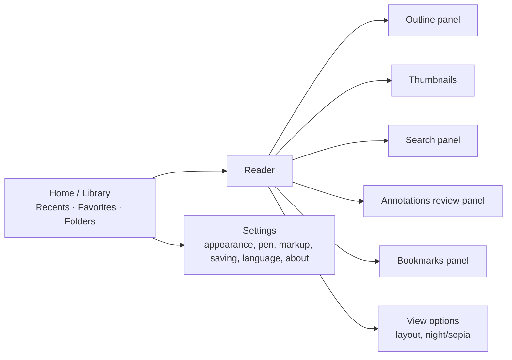

# 05 — UX Design

## 1. Design principles

1. **The page is the interface.** Chrome is minimal while reading and toolbars auto-hide. Tools appear where the hand already is.
2. **One gesture to mark up.** The highlighter, pen and eraser are always one tap away when a document is open.
3. **Predictable input.** The stylus always writes with the current pen. Fingers read (scroll, zoom, tap), and finger tools are picked from the toolbar. Mouse/keyboard follow desktop conventions.
4. **Familiar, not copied.** Reading and annotating should feel very close to the most popular commercial mobile PDF readers, so people switching to Doxa feel at home ([§8](#8-familiar-layout-and-workflows)). The visual identity stays Doxa's own: Material 3, own logo, icons and colours ([Vision §3](01-vision-and-scope.md#3-product-inspiration-and-originality)).

## 2. Screen map

## 3. Reader layout by size class

| Size class | Layout |
|---|---|
| **Compact** (phones) | Top app bar (auto-hide) + bottom **annotation toolbar** in annotate mode. Panels open as full-screen sheets. |
| **Medium** (small tablets, split screen) | Tabs row + annotation toolbar **fixed at the top**. Panels open as modal side sheets. |
| **Expanded** (large tablets, desktop) | Tabs row, annotation toolbar **fixed at the top**, left **navigation rail** for panels (outline/thumbnails/review/bookmarks) as a resizable side pane. |

### Annotation toolbar (all sizes)
`[Highlighter ▾] [Underline/Strike ▾] [Pen 1] [Pen 2] [Highlighter pen] [Eraser ▾] [Lasso] [Note] [Shapes ▾] | [Undo] [Redo] | [Stylus-only ✎]`

- Long-press or a second tap on a tool opens its options (color palette, width, opacity, pressure).
- Tool state is **sticky** until the user switches tools or presses Esc or the back gesture.
- The current color appears as the tool's tint, so the state is visible at a glance.

## 4. Key interactions

| Scenario | Touch | Stylus | Mouse/keyboard |
|---|---|---|---|
| Scroll/zoom | Drag / pinch | Drag (if stylus-only off) | Wheel / Ctrl+wheel |
| Select text | Long-press, then handles | Long-press or side button | Click-drag |
| Look up a word | Select it → **Dictionary** (popup; bottom sheet on phones) | Same | Select → Dictionary (context menu) |
| Highlight (tool active) | Drag over text | Drag over text | Drag |
| Write | Pen tool | Always writes in stylus-only mode | Pen tool + drag |
| Erase | Eraser tool | Eraser tip / side button | Eraser tool, or `E` |
| Undo | Two-finger tap (optional), toolbar | — | Ctrl+Z / Ctrl+Shift+Z |
| Edit annotation | Tap → context bar | Tap | Click, Delete key |

Default desktop shortcuts: `H` highlight, `U` underline, `P` pen, `E` eraser, `L` lasso, `N` note, `Esc` back to view,
`Ctrl+F` search, `Ctrl+O` open, `Ctrl+W` close tab, `Ctrl+Tab` next tab, `F11` fullscreen, `Ctrl+0/1/2` zoom presets.

## 5. Visual design

- Material 3 with a **Doxa seed color** and dynamic color on Android 12+.
- Default palette for study markup, chosen for legibility under multiply blend and tuned for color-vision deficiencies: yellow, green, blue, pink, orange, purple. Users can relabel colors (for example "Definition", "Exam", "Doubt"), and the labels drive review-panel filtering.
- App icon and brand assets are original. The **provisional icon** is a lowercase delta (δ, for δόξα) drawn as one stroke in four
  colours, magenta → green → purple → orange, with hard joins; its bowl closes by passing under the stem. Sources are in
  [`assets/brand/`](../../assets/brand/) (dark, light, transparent, Android adaptive foreground, single-colour). The full branding
  will be revisited later; a designer contribution is welcome.

## 6. Accessibility

- Semantic labels on every control, with tooltips on desktop.
- Full keyboard navigation and a visible focus indicator.
- Respects OS text scaling and reduced motion. High-contrast theme.
- Annotation colors are never the only signal: the review panel also shows type icons and color labels.

## 7. Decisions from the MVP session (2026-11-24)
- **No explicit annotate mode for the stylus**: the S Pen always writes. Finger tools (markup, notes, shapes) are chosen in the toolbar, and otherwise the finger only reads.
- **Toolbar fixed at the top** on tablets. Phones use the compact bottom toolbar.
- **Tabs on tablets** as well as desktop.

### Still open
- Toolbar placement on landscape phones.

## 8. Familiar layout and workflows

Maintainer decision (2026-11-24): the viewer should **strongly resemble the layout and workflows of the leading commercial mobile PDF readers** without being an exact copy.

| Resemble (layout, flows, conventions) | Keep original (identity) |
|---|---|
| Screen structure: top app bar, document tabs, annotation toolbar at the top, side/bottom panels | Name, logo, app icon, splash |
| Tool order and grouping in the annotation toolbar; long-press for tool options | Icon set (Material Symbols), illustrations |
| Viewing modes, page navigation, thumbnail grid, outline and annotation list panels | Colour palette (Doxa seed colour) and typography |
| Gestures: pinch/double-tap zoom, swipe paging, tap to show/hide chrome | UI texts and help content (written by us) |
| Annotation selection handles, context menu actions, colour/thickness pickers | Store listing, screenshots and marketing |

Why: familiar workflows lower the switching cost, while copying trade dress (the distinctive overall look) or branding would create trademark and
copyright risk (R10) and could mislead users about affiliation. **No other product is named in this repository.** Detailed screen-by-screen references
are agreed with the maintainer outside the repo and recorded here only as generic requirements.

## 9. Getting a dictionary

Maintainer decision (2026-11-25): within [ADR-0009](../adr/0009-offline-dictionary.md) (user-imported, never bundled), a student must
never have to search the web for a dictionary. Getting the first one takes about three taps (FR-TEXT-008, FR-TEXT-009, FR-TEXT-012).

1. **Empty state.** Tapping **Dictionary** with no dictionary installed opens the usual popup (bottom sheet on phones) with a short explanation
   and two actions: **Get dictionaries** and **Import file**. Settings → Dictionaries shows the same empty state.
2. **Get dictionaries** opens a Doxa project page in the browser with a short, curated list: Portuguese, English, Portuguese → English and
   English → Portuguese at first. Each entry is one `.zip` with its size, source and license. The browser downloads it, so the app itself never
   uses the network ([NFR-SEC-001](02-requirements.md#25-security--privacy-sec)).
3. **Import in one step.** Opening the downloaded `.zip` offers Doxa in "Open with". Doxa imports, validates and enables it, then confirms with a
   snackbar. **Import file** opens the system picker, which starts in Downloads when possible.

The packs are **built by Doxa** from free sources (Wiktionary via Wiktextract, CC BY-SA; WordNet for a compact English option), converted to
StarDict by a script in `tools/` and published as release assets with their SHA-256, attribution and license file. Built packs keep the
quality, the links and the attribution under our control. Users can still import any other StarDict dictionary.

Import is forgiving: a `.zip` with nested folders, a folder, or loose files all work, and a missing companion file (`.idx`, `.dict`) is
named in a clear error. Settings → Dictionaries lists each dictionary with its name, size and source, and lets the user enable, disable,
reorder and remove it.
