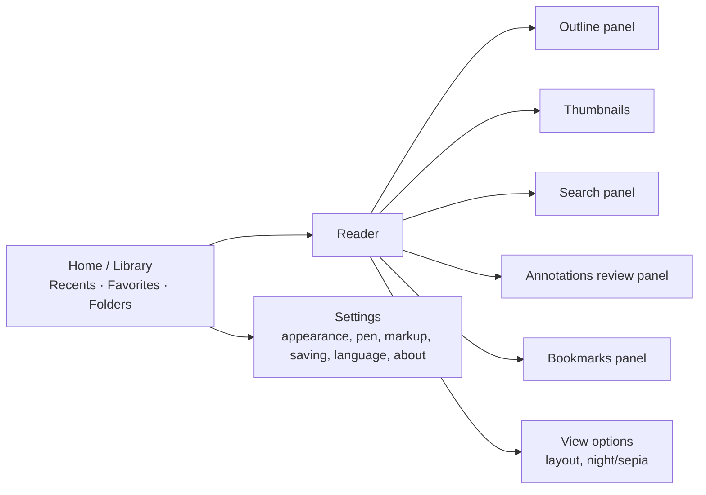

# 05 — UX Design

## 1. Design principles

1. **The page is the interface.** Chrome is minimal while reading and toolbars auto-hide. Tools appear where the hand already is.
2. **One gesture to mark up.** The highlighter, pen and eraser are always one tap away when a document is open.
3. **Predictable input.** Stylus writes, finger navigates (when stylus-only is on), and mouse/keyboard follow desktop conventions.
4. **Original look.** Material 3 with Doxa's own identity. No visual copying of other apps ([Vision §3](01-vision-and-scope.md#3-product-inspiration-and-originality)).

## 2. Screen map

## 3. Reader layout by size class

| Size class | Layout |
|---|---|
| **Compact** (phones) | Top app bar (auto-hide) + bottom **annotation toolbar** in annotate mode. Panels open as full-screen sheets. |
| **Medium** (small tablets, split screen) | Floating, draggable **tool palette**. Panels open as modal side sheets. |
| **Expanded** (large tablets, desktop) | Tabs row, left **navigation rail** for panels (outline/thumbnails/review/bookmarks) as a resizable side pane, floating or docked tool palette. |

### Annotation toolbar (all sizes)
`[Highlighter ▾] [Underline/Strike ▾] [Pen 1] [Pen 2] [Highlighter pen] [Eraser ▾] [Lasso] [Note] [Shapes ▾] | [Undo] [Redo] | [Stylus-only ✎]`

- Long-press or a second tap on a tool opens its options (color palette, width, opacity, pressure).
- Tool state is **sticky** until the user switches tools or presses Esc or the back gesture.
- The current color appears as the tool's tint, so the state is visible at a glance.

## 4. Key interactions

| Scenario | Touch | Stylus | Mouse/keyboard |
|---|---|---|---|
| Scroll/zoom | Drag / pinch | Drag (if stylus-only off) | Wheel / Ctrl+wheel |
| Select text | Long-press, then handles | Long-press or side button | Click-drag |
| Highlight (tool active) | Drag over text | Drag over text | Drag |
| Write | Pen tool | Always writes in stylus-only mode | Pen tool + drag |
| Erase | Eraser tool | Eraser tip / side button | Eraser tool, or `E` |
| Undo | Two-finger tap (optional), toolbar | — | Ctrl+Z / Ctrl+Shift+Z |
| Edit annotation | Tap → context bar | Tap | Click, Delete key |

Default desktop shortcuts: `H` highlight, `U` underline, `P` pen, `E` eraser, `L` lasso, `N` note, `Esc` back to view,
`Ctrl+F` search, `Ctrl+O` open, `Ctrl+W` close tab, `Ctrl+Tab` next tab, `F11` fullscreen, `Ctrl+0/1/2` zoom presets.

## 5. Visual design

- Material 3 with a **Doxa seed color** and dynamic color on Android 12+.
- Default palette for study markup, chosen for legibility under multiply blend and tuned for color-vision deficiencies: yellow, green, blue, pink, orange, purple. Users can relabel colors (for example "Definition", "Exam", "Doubt"), and the labels drive review-panel filtering.
- App icon and brand assets are original. A designer contribution is welcome (tracked as an issue).

## 6. Accessibility

- Semantic labels on every control, with tooltips on desktop.
- Full keyboard navigation and a visible focus indicator.
- Respects OS text scaling and reduced motion. High-contrast theme.
- Annotation colors are never the only signal: the review panel also shows type icons and color labels.

## 7. Open UX questions (for the MVP session)
- Should annotate mode be explicit (enter/exit) or modeless (tools always live)?
- Bottom vs. side toolbar on landscape phones.
- Do tabs appear on tablets, or only on desktop?
