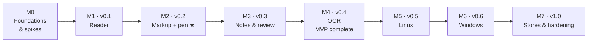

# 08 — Roadmap

Milestones are defined by **scope and exit criteria**, not dates. Each milestone ends with a tagged release that users can install.
The MVP (M1–M4) is **Android-only** and detailed in [11 — MVP Definition](11-mvp.md).

## M0 — Foundations & technical spikes (Android focus)
Goal: prove the risky parts before building features.
- Repository, CI skeleton, lints, FVM pin, pub workspace, ADRs 0001–0004.
- `pdfium_ffi` bindings and binary fetching on Android (Linux too, as the CI/test host).
- **Spike A (rendering):** engine isolate + tiles + annotations-off rendering on a large textbook. Decide the foreign-annotation layer (→ ADR-0005).
- **Spike B (ink):** S Pen pressure/tilt/buttons in Flutter on the reference tablet, plus a latency measurement. Decide whether the native front-buffer path is needed (→ ADR-0006).
- **Spike C (write):** create a highlight and an ink annotation with our own appearance streams, save incrementally via SAF, verify in Acrobat, a commercial Android reader, pdf.js and Okular.
- **Spike D (OCR):** Tesseract on Android. Check speed per page on the reference tablet, model size, and writing an invisible text layer with PDFium (→ ADR-0007).

Exit: a spike report for each with go/no-go; ADRs recorded; [risks](09-risks.md) updated.

## M1 — v0.1 Reader (Android)
FILE-001..004, 006, 007 · VIEW-001..014 · TEXT-001, 002, 004 · BOOK-002 · SET-001, 002.
Exit: open and read large textbooks and articles on the reference tablet within the performance budgets.

## M2 — v0.2 Study core: markup + pen ★
MARK-001..005, 008..010 · INK-001..009, 011, 012 · TEXT-005..007 · NOTE-002 · ANNO-001, 002, 006 · SAVE-001..005 · FILE-010 · SET-003.
Exit: a student can highlight and handwrite through a whole chapter with the S Pen, without data loss; annotations interoperate with all [interop targets](11-mvp.md#1-target).

## M3 — v0.3 Notes & review
FILE-008 · TEXT-003 · MARK-006, 007, 011 · INK-010 · NOTE-001, 003..006 · ANNO-003..005, 008 · BOOK-001 · SAVE-006.
Exit: review panel, color labels, bookmarks, Markdown export, note pages and shapes complete the study workflow.

## M4 — v0.4 OCR → MVP complete
UTIL-001 · NFR-PERF-009 · performance and interop sweep.
Exit: the [MVP exit criteria](11-mvp.md#5-mvp-exit-criteria) are met.

## M5 — v0.5 Linux
Desktop layouts (expanded size class, side panels), keyboard shortcuts, FILE-009, XDG portals, tablet/pen input through GTK (desktop stylus spike first), Flatpak + AppImage on GitHub Releases.

## M6 — v0.6 Windows
Windows Ink/pen input, file associations, MSIX/Inno installer, code signing.

## M7 — v1.0 Stores & hardening
FILE-005 · MARK-012 · SET-004, 005 · accessibility audit · store listings (Google Play, F-Droid, Flathub, winget) · [success criteria](01-vision-and-scope.md#7-success-criteria) met.

## Post-1.0 candidates (order to be decided with the community)
1. Annotation sync via user-owned storage (FR-UTIL-006).
2. Page organization (FR-UTIL-002).
3. Forms & signatures, images → PDF, camera scanning (FR-UTIL-003..005).
4. Study extras: read-aloud, reading ruler, flashcards from highlights.
5. Broader editing (content editing, encryption/compression via qpdf), each starting with an ADR.
6. iOS/macOS builds.
